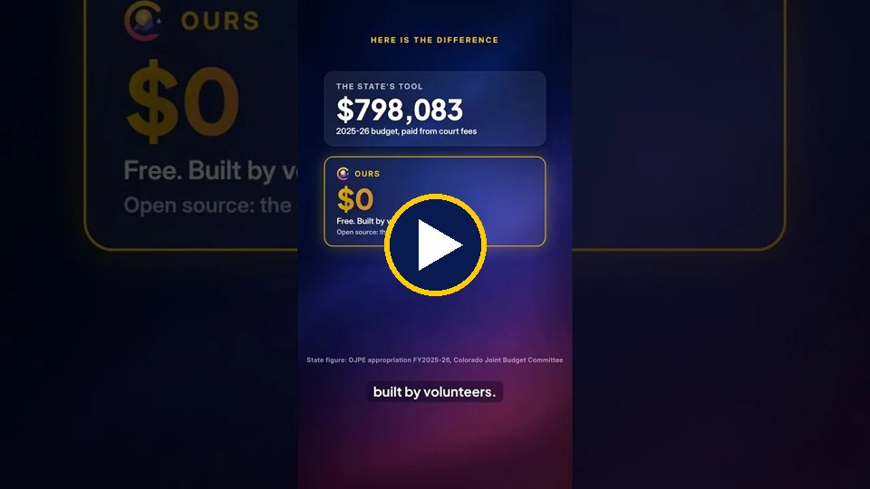
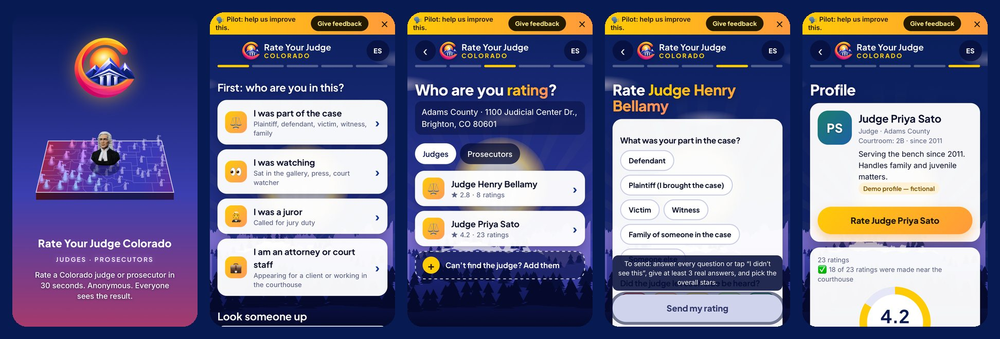
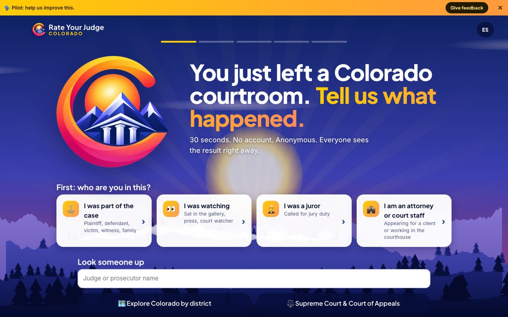
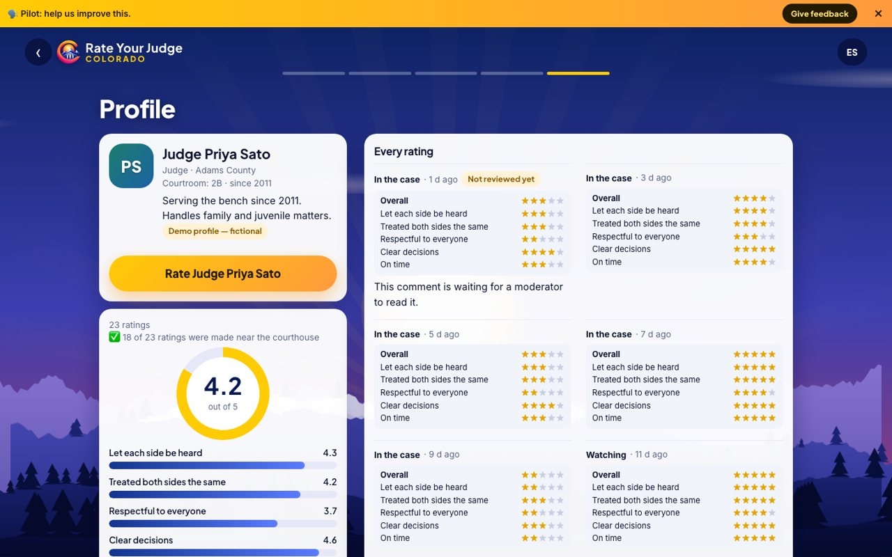
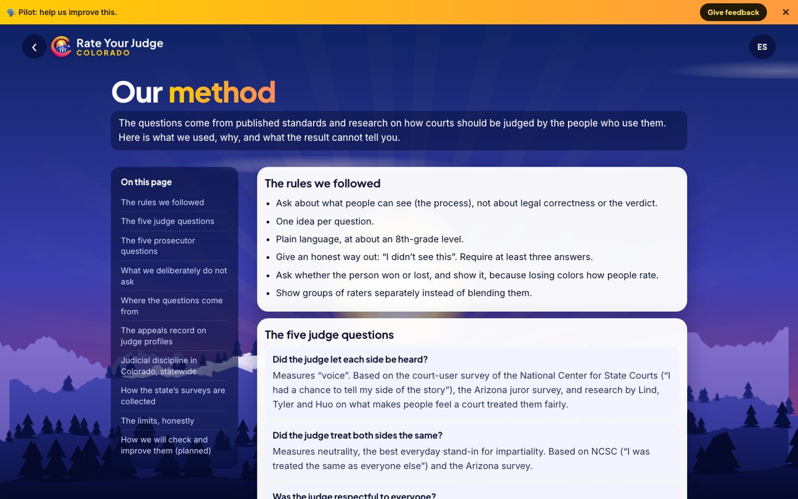
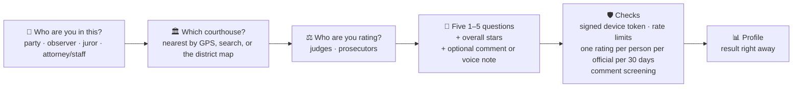
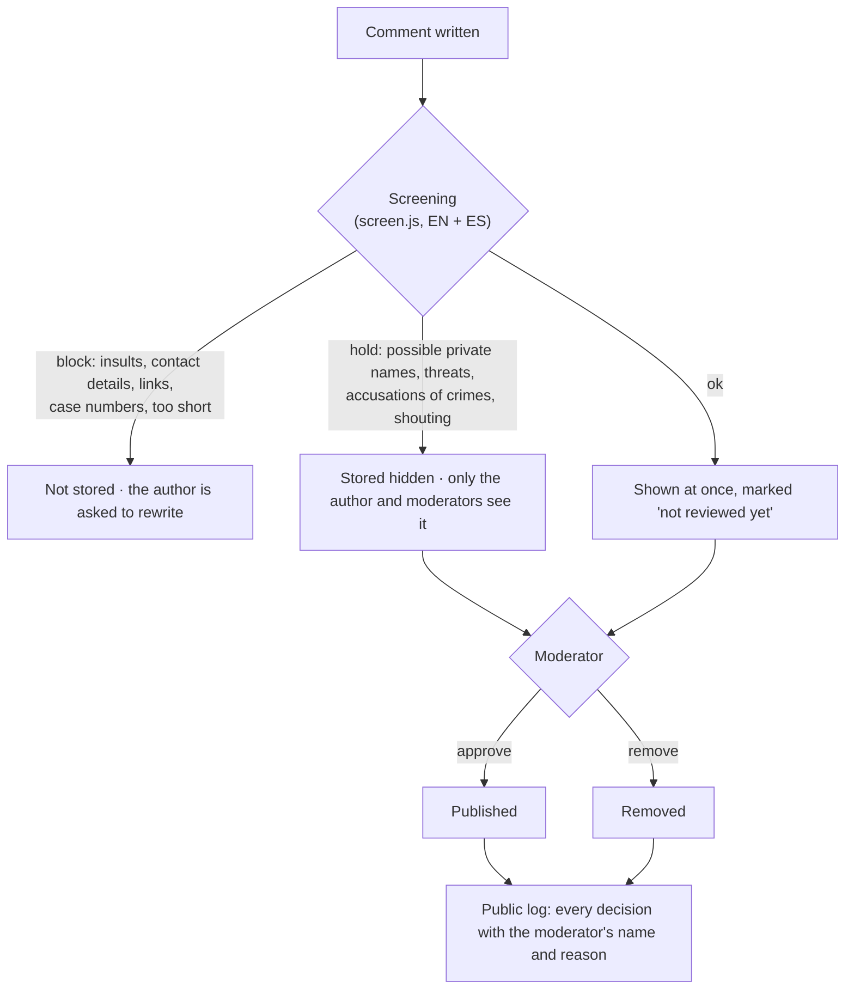
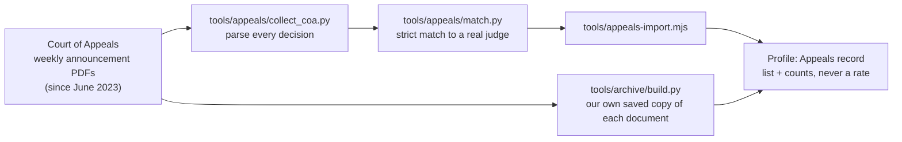

<p align="center">
  
</p>

<h1 align="center">Rate Your Judge Colorado</h1>

<p align="center">
  <b>Rate a Colorado judge or prosecutor in 30 seconds, from your phone. Anonymous. Everyone sees the result.</b><br>
  English and Spanish · no account · no ads · no outside trackers · open source (MIT)
</p>

<p align="center">
  <a href="https://rateyourjudgecolorado.com"><b>rateyourjudgecolorado.com</b></a> ·
  <a href="#how-a-score-is-built">How a score is built</a> ·
  <a href="#run-it-yourself">Run it yourself</a> ·
  <a href="#the-appeals-record">Appeals record</a> ·
  <a href="#privacy-and-security">Privacy</a>
</p>

---

## Why this exists

Every two years Colorado voters decide whether judges keep their jobs. The state's official evaluation program does
real work, but its own reports show how thin the public's part in it is:

- In the 2024 cycle, **117,355** members of the public were invited by email to evaluate judges. **6,614** answered: about 6 %.
- One district judge's 2024 report rests on **42** people; **18 of 1,072** invited attorneys responded.
- In the state's 2024 voter survey, **23 %** knew the evaluation commissions exist.
- There is **no** public rating of prosecutors at all.

The people who actually watch a judge work (parties, jurors, people in the gallery, attorneys) rarely get a simple way
to say what they saw. This site is that simple way, and this repository shows exactly how every number on it is made,
so anyone can check the math.

### The problem in three minutes

<a href="https://www.youtube.com/watch?v=s54P6zUTJQ4">
  
</a>

*Recorded on 13 October 2026, while the site still showed made-up demo people. It now lists real Colorado judges and prosecutors.*

---

## What it looks like

<p align="center"></p>

| Desktop home | A profile | How we score |
|---|---|---|
|  |  |  |

*Screenshots use the built-in demo data: fictional people, fictional ratings.*

---

## How it works



1. **Your part.** A person says how they were in the courtroom. People in the case can add their part
   (plaintiff, defendant, victim, witness, family). At the Supreme Court and the Court of Appeals there are no juries or
   witnesses, so ratings there come only from attorneys and from people who watched an oral argument.
2. **The courthouse.** The phone's location (if allowed) finds the nearest of Colorado's courthouses. Only a yes/no
   "was near the courthouse" is kept, never the location.
3. **Five questions + overall stars.** Each question is 1–5, or "I didn't see this". At least three real answers and
   the overall stars are required.

   | Judges | Prosecutors |
   |---|---|
   | Did the judge let each side be heard? | Was the prosecutor respectful to everyone in the courtroom? |
   | Did the judge treat both sides the same? | Did the prosecutor seem prepared? |
   | Was the judge respectful to everyone? | Did the prosecutor stick to the facts? |
   | Was it clear what the judge decided, and why? | Could you follow what the prosecutor was saying and doing? |
   | Did the judge run things on time? | Did the prosecutor treat witnesses and the defendant fairly? |

   Victims and witnesses rating a prosecutor get two extra questions; their answers are shown separately and never
   mixed into the main score. The research behind the wording is in [`docs/questions.md`](docs/questions.md).
4. **The result** shows at once on the person's profile.

---

## How a score is built

All of it is in [`server.js`](server.js), function `aggregate()`. No weighting, no hidden adjustments.

| Rule | Value | Why |
|---|---|---|
| Score | plain average of the 1–5 answers, rounded to 0.1 | anyone can recompute it |
| "I didn't see this" | left out of that question's average | an observer cannot judge what they could not see |
| Minimum before an average is public | **5 ratings** (`MIN_PUBLIC_N`) | one or two angry or friendly ratings must not become "the score" |
| Split views | by role, by part in the case, by how the case ended (won / lost / mixed / watching) | victims and defendants rate differently; showing them side by side is fairer than one blended number |
| "Near the courthouse" | counted, shown as "18 of 23 ratings were made near the courthouse" | a signal of presence, never a filter and never a location |
| Repeat ratings | one per person per official every **30 days** (`REPEAT_DAYS`) | stops stuffing, still lets a person rate a later hearing |

What a score is **not**: it is not a finding about a judge's legal correctness, and it is not a performance review. It
is what people in the courtroom saw, counted honestly.

---

## Comments and moderation



- Three publishing modes (`PUBLISH_MODE`): `visible` (shown at once, reviewed after), `mod` (a moderator must approve
  first) and `peer` (two confirmations from people who have themselves rated).
- Every moderator decision is on the public [moderation log](https://rateyourjudgecolorado.com/log.html) with the
  moderator's display name and the reason.
- Moderators sign in with personal accounts (scrypt-hashed passwords, optional one-time codes, lockout after repeated
  failures) on a **separate listener** that is never exposed with the public site.
- Comments are personal opinions of their authors. The site does not verify the facts in them and says so on every page.

---

## The appeals record

For every trial judge on the site, the profile lists the Colorado Court of Appeals decisions on that judge's rulings,
with citations and a link to the court's own document. For appellate judges it lists the decisions they wrote.



**Matching is strict on purpose**: a wrong judge on a public page is worse than a missing decision. A decision is
attached only when the trial court's judicial district, the judge's last name and first name (or initial) all agree,
and exactly one judge on the roster fits. Outcomes come from the court's own disposition line: affirmed, partly
affirmed, reversed, vacated, ruling disapproved, sent back, appeal dismissed.

**There is no reversal rate.** No public source counts every case a judge hears, so there is no honest denominator.
The site shows the list and the counts and explains that a reversal means a higher court disagreed on the law or the
procedure; it is not a finding of misconduct, and some kinds of cases are appealed and reversed far more than others.

---

## Not a survey: a system that keeps learning

The state's evaluation is a questionnaire sent out once every few years. This project is built the other way round:

- **It updates itself.** Ratings arrive every day. The appeals record refreshes every week from the Court of Appeals'
  new announcements. Rosters are re-checked against the courts' own lists. Nothing waits for the next election cycle.
- **It combines different kinds of evidence.** What people in the courtroom saw (the ratings) sits next to what a
  higher court did with a judge's rulings (the appeals record). Neither is mixed into the other: each is shown as
  itself, with its source, so a reader can weigh them.
- **Every step is open.** The math is plain, the code is here, and every moderator decision is on a public log.
  An ordinary person can see not only the result but how the result was made.

## Open questions: help us get this right

These are the parts we have not solved yet. If you work with data, statistics, courts or law, we would like your help.
Open an issue, or a pull request with the case you are making.

1. **How should the appeals record count?** A higher court's decisions on a judge's rulings are a real signal of how
   the work is done, but a raw count can mislead: busy courts produce more appeals, some kinds of cases are appealed and
   reversed far more than others, and there is no public count of every case a judge hears. What fair, explainable way
   is there to put that signal in context without inventing a rate?
2. **Which other public signals belong here?** For example: Supreme Court original proceedings on a trial judge's
   rulings, published opinions from before June 2023, recusals, case timeliness reports. What is reliable, public and
   fair to show next to a name?
3. **Trends over time.** How should the site show that a judge's ratings or appeals record is improving or getting
   worse, without over-reading a handful of data points?
4. **Fairness checks.** How do we detect, in the open, an organized campaign for or against one official, and what
   should the site do when it sees one?
5. **Wording.** Are the five questions for judges and for prosecutors the ones a layperson can actually answer from
   what they saw? The research so far is in [`docs/questions.md`](docs/questions.md).

We especially welcome **technologists** who can find signals in public court data, and **lawyers and judges** who can
tell us where a number would be unfair. Everything that is accepted becomes code here, where anyone can check it.

---

## Privacy and security

- **Nothing from other companies loads.** No ads, no analytics, no outside fonts or scripts; everything is served by
  the site itself. The one exception is the video on the About page: it plays from YouTube in privacy-enhanced mode,
  and nothing loads from YouTube until someone presses play.
- **No accounts.** A random token, signed by the server, identifies a phone; it is not tied to a name.
- **IP addresses are never written to the database.** They live briefly in memory to slow down abuse.
- **Voice notes** are turned into text on the site's own server (whisper.cpp) and the audio is deleted at once.
- **Strict headers**: a Content-Security-Policy that allows no inline or outside scripts, no framing of the site by others, no referrer sent out.
- **The time of a rating is rounded to the hour**, so it cannot be matched to a moment in a courtroom.
- **Self-hosted proof-of-work** on submissions (`CAPTCHA=1`), so no third-party captcha watches people.
- The security test suite starts throw-away servers and attacks them: [`tools/qa/security-tests.mjs`](tools/qa/security-tests.mjs).

Found a security problem? Please open a private report through GitHub's **Security → Report a vulnerability** instead of a public issue.

---

## Run it yourself

Requirements: **Node.js 24+** (uses the built-in `node:sqlite`). PostgreSQL is optional.

```bash
git clone https://github.com/brainframeterminal/rate-your-judge-colorado.git
cd rate-your-judge-colorado
npm install
openssl rand -hex 32 > data/secret.txt        # or set JUDEX_SECRET
SEED_DEMO=1 MOD_PORT=8751 npm start            # demo data: fictional people and ratings
```

Open <http://127.0.0.1:8750> for the site and <http://127.0.0.1:8751/mod.html> for the moderator dashboard.
Create a moderator account with `node tools/mod-admin.mjs add you@example.com "Display Name"`.

### Configuration

| Variable | Default | What it does |
|---|---|---|
| `PORT` | `8750` | public listener |
| `MOD_PORT` | off | moderator listener (keep it on a private network) |
| `DATABASE_URL` | – | PostgreSQL; without it, SQLite at `JUDEX_DB` (default `data/judex.db`) |
| `JUDEX_SECRET` | `data/secret.txt` | signs device tokens and sessions |
| `PUBLISH_MODE` | `peer` | `visible`, `mod` or `peer` (see moderation above) |
| `MIN_PUBLIC_N` | `5` | ratings needed before an average is shown |
| `REPEAT_DAYS` | `30` | how often one person may rate the same official |
| `VOTE_MIN_AGE_H` | `0` | only devices with an older rating may confirm or report (production: 24) |
| `CAPTCHA` | off | `1` turns on the self-hosted proof-of-work |
| `SEED_DEMO` | on | `0` for real data only |
| `TRUST_PROXY` | `1` | reverse-proxy hops in front of the app |
| `ALLOWED_HOSTS` | any | comma-separated Host names the app answers to |
| `JUDEX_MOD_2FA` | on | `0` signs moderators in with email + password only |
| `JUDEX_ARCHIVE` | `data/archive` | where saved copies of court documents live |
| `WHISPER_MODEL` | `$HOME/models/ggml-small.bin` | speech-to-text model for voice notes |

### Real data

- Courthouses: [`data/courts.json`](data/courts.json) (built by `tools/build_courts.py`), district map by `tools/build_map.py`.
- Officials: [`data/roster-*.json`](data) from the courts' and district attorneys' own published lists, each with its
  source and the date it was checked; load with `tools/roster-import.mjs`.
- Appeals: `tools/appeals/collect_coa.py` → `tools/appeals/match.py` → `tools/appeals-import.mjs`.
- Search-engine files (sitemap, `llms.txt`, pre-rendered pages): `node tools/build-seo.mjs` with the server running.

---

## Tests

```bash
npm install                                   # includes Playwright for the browser tests
npx playwright install chromium webkit
node tools/qa/func-tests.mjs                  # the real flow in phone Safari and Chrome engines (server running)
node tools/qa/security-tests.mjs              # starts its own throw-away servers
node tools/qa/screen-tests.mjs                # comment screening, English and Spanish
node tools/qa/mobile-audit.mjs                # every screen at phone widths: overflow, tap targets
```

Set `RYG_BASE` / `RYG_MOD_BASE` to test a server on another address.

---

## Project layout

```
server.js            the whole backend: HTTP, API, scoring, moderation, security headers (no framework)
db.js                one small database layer: SQLite for local use, PostgreSQL in production
screen.js            comment screening rules (EN + ES)
modauth.js           moderator password hashing and one-time codes
public/              the site: plain ES modules, no build step
  app.js             the rating flow and profiles
  i18n.js            every word on screen, English and Spanish
  pages.js           About, Method, Privacy, Security, Terms ...
  loader.js scene.js the animated sky, mountains and opening screen
bin/transcribe.sh    voice note → text (ffmpeg + whisper.cpp)
data/                courthouses and rosters
docs/questions.md    the research behind the rating questions
tools/               data pipelines, importers, test suites
```

---

## Contributing

Issues and pull requests are welcome, especially:

- corrections to the rosters (with a link to the official source),
- better Spanish,
- accessibility problems on real phones,
- anything in the scoring or matching that looks unfair: open an issue and show the case.

Please keep the project's rules: no third-party scripts, no personal data, and every public number must be traceable
to code in this repository or to an official source.

---

## License

[MIT](LICENSE). Use it, change it, run your own copy for your state.

Rate Your Judge Colorado is an independent project. It is not affiliated with the State of Colorado, the Colorado
Judicial Branch or any court. Ratings and comments are the opinions of the people who wrote them.
